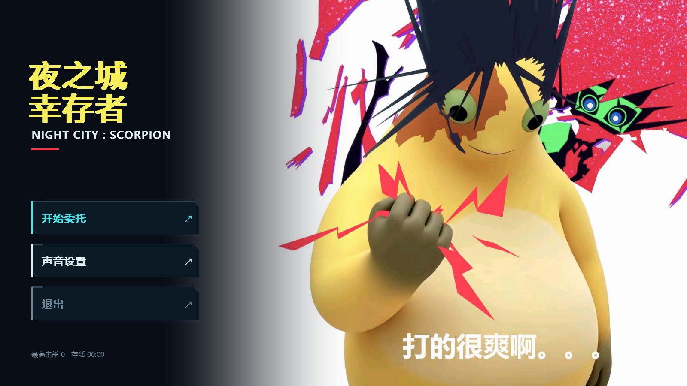
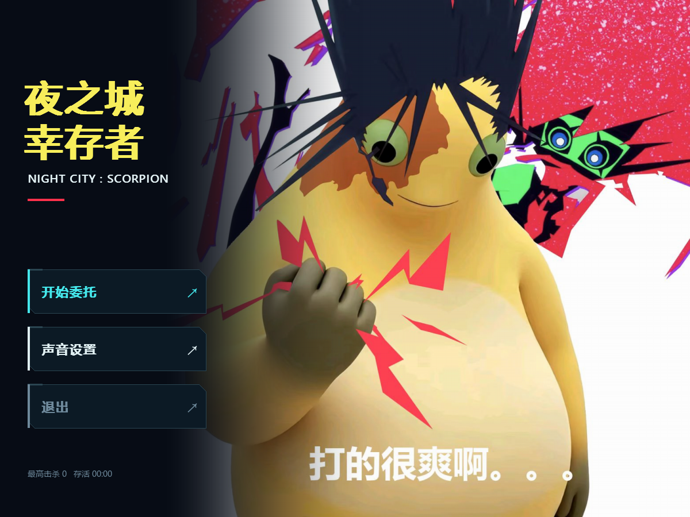

# Night City: Scorpion

Python + pygame-ce 制作的赛博朋克同人幸存者游戏。

## 运行

需要 Python 3.12 或更新版本。

```sh
python -m venv .venv
python -m pip install -r requirements.txt
python main.py
```

Windows 激活虚拟环境后，也可双击 `启动游戏.bat`。

WASD / 方向键移动，空格冲刺，P / Esc 暂停，1 / 2 / 3 选择升级，B / K 查看图鉴或能力目录。音量在主菜单或暂停菜单中调节。

## 开始界面

界面随窗口比例调整；可使用 `--menu-aspect 16:9` 或 `--menu-aspect 4:3` 启动。项目根目录也提供对应的 Windows 启动脚本。





## 开发与打包

```sh
python -m pip install -r requirements-dev.txt
python -m unittest discover -s tests -v
```

Windows 使用 `build.ps1` 生成独立运行包。运行素材已包含在 `assets/`；重新处理素材才需要 FFmpeg，以及自行提供的原始素材。通过 `SCORPION_ANIME_SOURCE` 指定包含 `season1/`、`season2/` 的本地目录。

## 素材与隐私

第三方声音的作者、出处、许可和校验值保留在 `assets/sfx_manifest.json` 与 `assets/licenses/`。其他素材的原有权利归属保持不变。

原始视频、个人参考资料、存档、编辑工程、截图、构建产物、个人设备路径和认证信息不纳入版本控制。提交前可运行：

```sh
python tools/check_privacy.py --tracked
```
